<p align="center">
  
</p>

# 🧠 Awesome Enterprise Knowledge Graph Generative Stacks

<p align="center">
  <a href="https://github.com/ishandutta2007/Awesome-Awesome-Awesome"></a><a href="https://discord.gg/jc4xtF58Ve"></a>
  <a href="https://github.com/ishandutta2007/Awesome-Enterprise-Knowledge-Graph-Generative-Stacks/stargazers"></a>
  <a href="https://github.com/ishandutta2007/Awesome-Enterprise-Knowledge-Graph-Generative-Stacks/network/members"></a>
  <a href="https://github.com/ishandutta2007/Awesome-Enterprise-Knowledge-Graph-Generative-Stacks/pulls"></a>
  <a href="https://github.com/ishandutta2007/Awesome-Enterprise-Knowledge-Graph-Generative-Stacks/blob/main/LICENSE"></a>
  <a href="https://github.com/ishandutta2007"></a>
</p>

> **The definitive directory of Enterprise Knowledge Graph (EKG) generative stacks, Graph Databases, GraphRAG engines, semantic reasoning layers, and change-aware data infrastructure.**

An authoritative, SEO-indexed, curated repository tracking enterprise-grade **SaaS platforms** and **open-source GitHub projects**. These technologies empower modern data engineering and AI platform teams to model, store, traverse, and synchronize highly connected relational data—grounding Generative AI, LLM agents, and complex analytical systems in structured, verifiable, and hallucination-free business truth.

---

## 📑 Table of Contents

- [🌐 Sector Overview & Market Dynamics](#-sector-overview--market-dynamics)
- [🏢 SaaS & Hosted Platforms](#-saas--hosted-platforms)
- [⚡ Open-Source GitHub Projects (Ranked by Stars)](#-open-source-github-projects-ranked-by-stars)
- [🧩 Specialized Embedded & Agent-Native Graph Tools](#-specialized-embedded--agent-native-graph-tools)
- [🛠️ Architectural Guidance & Stack Selection](#-architectural-guidance--stack-selection)
- [🤝 How to Contribute](#-how-to-contribute)
- [💖 Support & Sponsorship](#-support--sponsorship)
- [📈 Star History](#-star-history)
- [⚖️ Disclaimer & Compliance](#️-disclaimer--compliance)

---

## 🌐 Sector Overview & Market Dynamics

- **Estimated Market Size**: The global Graph Database and Enterprise Knowledge Graph market is valued at **$3.2 Billion in 2024** and is projected to expand to **$14.8+ Billion by 2030–2032**, registering a compound annual growth rate (**CAGR of ~23.5%**). This acceleration is catalyzed by enterprise adoption of **GraphRAG**, neuro-symbolic AI grounding, autonomous agents, and enterprise data virtualization.
- **Market Concentration & Dynamics**: The sector is **moderately fragmented**: while public cloud hyperscalers (such as AWS Neptune) and graph market leaders (Neo4j) maintain substantial enterprise market share, the market resists a single "winner-take-all" outcome. Distinct workload demands have fostered thriving specialization: ultra-fast distributed Massively Parallel Processing (MPP) engines (TigerGraph), strict semantic W3C RDF/SPARQL ontologies (Ontotext, Stardog), zero-ETL lakehouse virtualization (PuppyGraph), and an expansive ecosystem of open-source GraphRAG frameworks.

---

## 🏢 SaaS & Hosted Platforms

A comprehensive comparison of top commercial managed and SaaS knowledge graph platforms, sorted descending by **Company Size (Revenue / Valuation)**.

| Platform / Vendor | Company Size (Valuation / Revenue) | Starting Tier Pricing | Free Tier Limits | Key Highlights & Architecture |
| :--- | :--- | :--- | :--- | :--- |
| **[Amazon Neptune](https://aws.amazon.com/neptune/)** | **Parent: ~$2.1T** (Amazon Market Cap / AWS ~$105B ARR) | **$0.068/hr** (~$49.00/mo) for `db.t4g.medium` instance or **$0.03/NCU-hr** (~$21.60/mo) Serverless | **30-Day Free Trial**: 750 hrs/mo of `db.t3.medium` or `db.t4g.medium`, 10M I/O requests, and 1 GB storage | Multi-model graph engine supporting openCypher, Gremlin, and SPARQL; serverless Neptune Analytics for fast graph algorithms without DB cluster provisioning. |
| **[Cambridge Semantics (AnzoGraph)](https://www.cambridgesemantics.com/)** | **Parent: ~$10.6B** (Acquired by Altair; Siemens $10.6B buyout) | **$1.50/hr** (~$1,080.00/mo) on AWS Marketplace (or $15,000/yr annual enterprise contract) | **Free Edition (Forever Free)**: Single-server instance capped at 8 GB RAM (up to 16 GB with free registration); or 60-day enterprise evaluation | Massively parallel processing (MPP) native graph database built for enterprise analytics, SPARQL 1.1 queries, data fabric mapping, and graph algorithms. |
| **[Neo4j (AuraDB)](https://neo4j.com/)** | **$2.0B Valuation** (Series F; ~$160M ARR) | **$65.00/mo** ($0.09/hr) for AuraDB Professional (1 GB RAM, 2 GB storage) | **AuraDB Free (Forever Free)**: 1 database, 200,000 nodes, 400,000 relationships, 1 vCPU, 2 GB RAM (pauses after 3 days of inactivity, resumable) | Industry standard for labeled property graphs with native Cypher query language, integrated vector search for GraphRAG, Bloom visualization, and GDS algorithms. |
| **[TigerGraph](https://www.tigergraph.com/)** | **~$500M Valuation** (Series C; ~$35M ARR) | **$0.24/hr** (~$175.00/mo) or **$45.00/GB/mo** for TigerGraph Savanna Cloud | **Cloud Free Tier (Forever Free)**: 1 instance with 4 vCPUs, 16 GB memory, 50 GB storage (auto-sleeps after 1 hr of inactivity, resumable) | Distributed native MPP graph database built for deep multi-hop traversal scalability; GSQL query language with openCypher support and hybrid graph+vector search. |
| **[data.world](https://data.world/)** | **~$350M Valuation** (Series C; ~$40M ARR) | **$12.00/user/mo** for Individual Pro plan (billed monthly) | **Community Plan (Forever Free)**: Up to 3 private projects, 100 MB max per dataset, 1 GB total storage, and 3 live data virtualization tables | Cloud-native enterprise data catalog founded on semantic knowledge graph architecture, data governance, lineage tracking, and automated SPARQL integration. |
| **[Stardog](https://www.stardog.com/)** | **~$180M Valuation** (Series B; ~$25M ARR) | **$499.00/mo** for Stardog Cloud Essentials (or $5.553/hr pay-as-you-go on AWS Marketplace) | **Stardog Free (Forever Free)**: Hosted shared cloud deployment capped at 1,000,000 edges and 3 databases; or 14-day Stardog Cloud Enterprise trial | Enterprise knowledge graph platform with SPARQL 1.1, OWL/SWRL semantic reasoning, Voicebox LLM query assistant, and federated virtual graph data integration. |
| **[Katana Graph](https://katanagraph.com/)** | **~$100M Valuation** (Series A; ~$12M Revenue) | **$1.20/hr** (~$864.00/mo) on AWS Marketplace AMI software licensing (or $25,000/yr starter contract) | **30-Day Free Trial** on AWS Marketplace AMI, or 14-day cloud sandbox trial with up to 100M edges and 4 vCPUs | Scalable high-performance graph intelligence engine engineered for massive parallel multi-core/GPU graph mining, pattern search, and large-scale AI workloads. |
| **[Diffbot](https://www.diffbot.com/)** | **~$75M Valuation** (Venture funded; ~$15M ARR) | **$299.00/mo** for Startup Plan (includes 250,000 credits/mo, 5 requests/sec) | **Free Tier (Forever Free)**: 10,000 credits/month (5 calls/min rate limit, up to 10k page extracts or 400 KG entity exports) | Autonomous web-scale knowledge graph continuously crawling and structuring billions of entities and relationships with real-time NLP extraction APIs. |
| **[Ontotext GraphDB](https://www.ontotext.com/)** | **Parent: ~$55M** (Sirma Group BSE: SKK; Ontotext ~$18M ARR) | **$1,200.00/yr** (~$100.00/mo) for Standard Edition on-premise (or $1.37/hr on AWS Marketplace) | **Free Edition (Forever Free)**: Free forever on-premises license, capped at 2 concurrent query executions and 5 repositories | W3C-compliant semantic graph database with RDF/SPARQL 1.1, text mining, SHACL validation, and high-performance semantic inferencing for enterprise knowledge management. |
| **[PuppyGraph](https://www.puppygraph.com/)** | **~$25M Valuation** (Seed $5M; Venture-backed) | **$0.90/hr** (~$648.00/mo) on AWS Marketplace for r6i.2xlarge compute tier | **Developer Edition (Forever Free)**: Single-node local Docker deployment with unlimited time; or 30-day Enterprise free trial on AWS Marketplace | Zero-ETL graph query engine that queries data in Snowflake, Databricks, BigQuery, and Apache Iceberg/Delta Lake as a unified graph model with zero data duplication. |

---

## ⚡ Open-Source GitHub Projects (Ranked by Stars)

A curated list of leading open-source repositories for knowledge graph storage, GraphRAG, network science, and semantic pipelines, strictly ordered by GitHub stargazers count descending.

1. **[LangChain](https://github.com/langchain-ai/langchain)** [](https://github.com/langchain-ai/langchain/stargazers)  
   The industry standard orchestration framework for LLM applications, offering graph construction chains, Cypher QA chains, and GraphRAG retrieval pipelines.

2. **[Mem0](https://github.com/mem0ai/mem0)** [](https://github.com/mem0ai/mem0/stargazers)  
   The self-improving memory layer for AI agents, integrating persistent graph storage and vector embeddings to maintain dynamic relational context across user interactions.

3. **[LlamaIndex](https://github.com/run-llama/llama_index)** [](https://github.com/run-llama/llama_index/stargazers)  
   Leading document processing and retrieval platform for AI, featuring `KnowledgeGraphIndex`, property graph indices, and hybrid GraphRAG extractors.

4. **[Apache Spark (GraphX)](https://github.com/apache/spark)** [](https://github.com/apache/spark/stargazers)  
   Unified big-data analytics engine with GraphX, enabling distributed graph-parallel computation, PageRank, connected components, and Pregel-based algorithms.

5. **[LightRAG](https://github.com/HKUDS/LightRAG)** [](https://github.com/HKUDS/LightRAG/stargazers)  
   High-performance, dual-level retrieval-augmented generation framework indexing both low-level entities and high-level themes into structured knowledge graphs.

6. **[Microsoft GraphRAG](https://github.com/microsoft/graphrag)** [](https://github.com/microsoft/graphrag/stargazers)  
   Modular graph-based RAG system by Microsoft that extracts entities, relationships, claims, and hierarchical community summaries for holistic question answering.

7. **[Apache Flink (Gelly)](https://github.com/apache/flink)** [](https://github.com/apache/flink/stargazers)  
   Distributed real-time streaming framework featuring the Gelly graph processing library for streaming graph mutations and continuous analytics.

8. **[PyTorch Geometric (PyG)](https://github.com/pyg-team/pytorch_geometric)** [](https://github.com/pyg-team/pytorch_geometric/stargazers)  
   Leading deep learning library for Graph Neural Networks (GNNs), link prediction, relational graph representations, and node classification on relational structures.

9. **[Dgraph](https://github.com/dgraph-io/dgraph)** [](https://github.com/dgraph-io/dgraph/stargazers)  
   Distributed native graph database with a GraphQL API (Apache 2.0). Features horizontal scaling with Raft consensus, synchronous replication, and ACID transactions.

10. **[NetworkX](https://github.com/networkx/networkx)** [](https://github.com/networkx/networkx/stargazers)  
    The premier Python package for the creation, manipulation, and study of the structure, dynamics, and functions of complex networks and graph theory algorithms.

11. **[Neo4j Community Edition](https://github.com/neo4j/neo4j)** [](https://github.com/neo4j/neo4j/stargazers)  
    The open-source core of the industry-standard native graph database featuring Cypher query execution and property graph storage (GPL v3).

12. **[Cayley](https://github.com/cayleygraph/cayley)** [](https://github.com/cayleygraph/cayley/stargazers)  
    Open-source graph database inspired by Freebase and Google Knowledge Graph, written in Go with pluggable backends (PostgreSQL, LevelDB, Bolt).

13. **[Deep Graph Library (DGL)](https://github.com/dmlc/dgl)** [](https://github.com/dmlc/dgl/stargazers)  
    Framework-agnostic Python package built to accelerate deep learning on graph-structured data and knowledge graph link prediction across PyTorch, TensorFlow, and MXNet.

14. **[ArangoDB](https://github.com/arangodb/arangodb)** [](https://github.com/arangodb/arangodb/stargazers)  
    Native multi-model database combining graph, JSON document, full-text search, and vector search with the declarative AQL query language (Apache 2.0).

15. **[NebulaGraph](https://github.com/vesoft-inc/nebula)** [](https://github.com/vesoft-inc/nebula/stargazers)  
    Distributed native graph database built for horizontally scaled enterprise deployments, handling trillions of vertices and edges with high-throughput nGQL queries.

16. **[Sigma.js](https://github.com/jacomyal/sigma.js)** [](https://github.com/jacomyal/sigma.js/stargazers)  
    High-performance JavaScript library leveraging WebGL to render and explore massive interactive graphs with tens of thousands of nodes and edges.

17. **[Cytoscape.js](https://github.com/cytoscape/cytoscape.js)** [](https://github.com/cytoscape/cytoscape.js/stargazers)  
    Feature-complete graph theory analysis and network visualization library in JavaScript for desktop and responsive web applications.

18. **[FalkorDB](https://github.com/FalkorDB/FalkorDB)** [](https://github.com/FalkorDB/FalkorDB/stargazers)  
    Apache 2.0 licensed graph database with 95%+ Cypher compatibility. Built on GraphBLAS sparse matrix linear algebra, delivering ultra-low latency execution for GraphRAG.

19. **[JanusGraph](https://github.com/JanusGraph/janusgraph)** [](https://github.com/JanusGraph/janusgraph/stargazers)  
    Scalable open-source distributed graph database with pluggable storage backends (Apache Cassandra, HBase, ScyllaDB, BerkeleyDB) and Apache TinkerPop Gremlin support.

20. **[LLM Graph Builder](https://github.com/neo4j-labs/llm-graph-builder)** [](https://github.com/neo4j-labs/llm-graph-builder/stargazers)  
    Official Neo4j application converting unstructured documents (PDFs, YouTube transcripts, web articles) into structured knowledge graphs using LLMs.

21. **[Apache AGE](https://github.com/apache/age)** [](https://github.com/apache/age/stargazers)  
    PostgreSQL extension adding graph database capabilities (Apache 2.0), enabling users to execute openCypher queries directly alongside standard SQL relational tables.

22. **[Memgraph](https://github.com/memgraph/memgraph)** [](https://github.com/memgraph/memgraph/stargazers)  
    In-memory C++ graph database with 100% Cypher compatibility, native Kafka/Pulsar streaming ingestion, and 50+ built-in graph algorithms (BSL source-available).

23. **[DeepKE](https://github.com/zjunlp/DeepKE)** [](https://github.com/zjunlp/DeepKE/stargazers)  
    Comprehensive toolkit for Knowledge Graph extraction, relation extraction, named entity recognition (NER), and multimodal knowledge graph construction.

24. **[Kùzu](https://github.com/kuzudb/kuzu)** [](https://github.com/kuzudb/kuzu/stargazers)  
    Embedded property graph database built for extreme speed and scalability, featuring Cypher queries, vector search, columnar storage, and native Python/DuckDB zero-copy integrations.

25. **[Nano-GraphRAG](https://github.com/gusye1234/nano-graphrag)** [](https://github.com/gusye1234/nano-graphrag/stargazers)  
    A clean, lightweight, easy-to-hack GraphRAG implementation with minimal dependencies, designed for fast prototyping and low token usage.

26. **[Fast-GraphRAG](https://github.com/circlemind-ai/fast-graphrag)** [](https://github.com/circlemind-ai/fast-graphrag/stargazers)  
    Intelligent, interpretable, and adaptive GraphRAG engine that automatically creates personalized domain knowledge graphs with integrated entity resolution.

27. **[TerminusDB](https://github.com/terminusdb/terminusdb)** [](https://github.com/terminusdb/terminusdb/stargazers)  
    Open-source document graph database with Git-like revision control, schema enforcement, time-travel queries, and branching workflows (Apache 2.0).

28. **[RDFLib](https://github.com/RDFLib/rdflib)** [](https://github.com/RDFLib/rdflib/stargazers)  
    The foundational Python library for working with RDF graphs, parsing and serializing (Turtle, JSON-LD, XML), and executing SPARQL 1.1 queries.

29. **[OpenSPG](https://github.com/OpenSPG/openspg)** [](https://github.com/OpenSPG/openspg/stargazers)  
    Knowledge graph engine developed by Ant Group and Zhejiang University, supporting semantic property graphs (SPG), schema governance, and neuro-symbolic reasoning.

30. **[igraph](https://github.com/igraph/igraph)** [](https://github.com/igraph/igraph/stargazers)  
    High-performance network analysis and community detection library written in C with bindings for Python and R, handling millions of graph vertices.

31. **[Apache Jena](https://github.com/apache/jena)** [](https://github.com/apache/jena/stargazers)  
    The standard open-source Java framework for RDF, OWL ontology reasoning, and SPARQL querying, bundled with the Fuseki server and TDB database (Apache 2.0).

---

## 🧩 Specialized Embedded & Agent-Native Graph Tools

Modern specialized libraries designed for local embedding, Model Context Protocol (MCP) servers, and zero-infrastructure pipelines:

- **[OverGraph](https://pypi.org/project/overgraph/)** — Embedded graph database with dense/sparse/hybrid vector search across Rust, Node.js, and Python. Supports graph-scoped vector search, temporal edges, and atomic graph patches.
- **[trikedb](https://pypi.org/project/trikedb/)** — YAML-file knowledge graph with SPARQL, vector search, and Model Context Protocol (MCP) server. Features `AFFECTED_BY` temporal edges for change traceability and OWL/SHACL validation.
- **[Flexible GraphRAG](https://pypi.org/project/flexible-graphrag-mcp/)** — Open-source GraphRAG platform with MCP server and OAuth2 security. Connects to 14 enterprise data sources (SharePoint, Google Drive, S3, Box).
- **[Leangraph](https://www.npmjs.com/package/leangraph)** — Lightweight embedded graph database with Cypher support for Node.js and TypeScript applications.
- **[Ontograph](https://pypi.org/project/ontograph/)** — LLM-driven knowledge graph engine featuring orbit proximity scoring, phonetic/semantic composite matching, and ontological entity resolution.

---

## 🛠️ Architectural Guidance & Stack Selection

```
┌────────────────────────────────────────────────────────────────────────┐
│               Enterprise Knowledge Graph Generative Stack              │
└────────────────────────────────────────────────────────────────────────┘
                                    │
           ┌────────────────────────┴────────────────────────┐
           ▼                                                 ▼
┌───────────────────────┐                         ┌───────────────────────┐
│ Property Graph Stacks │                         │ Semantic Web / RDF    │
│ (Cypher / GSQL)       │                         │ (SPARQL / OWL / SHACL)│
├───────────────────────┤                         ├───────────────────────┤
│ • Neo4j / AuraDB      │                         │ • Ontotext GraphDB    │
│ • FalkorDB (Apache 2) │                         │ • Stardog Platform    │
│ • TigerGraph (MPP)    │                         │ • Apache Jena         │
│ • Memgraph (In-Memory)│                         │ • RDFLib (Python)     │
└───────────────────────┘                         └───────────────────────┘
           │                                                 │
           └────────────────────────┬────────────────────────┘
                                    ▼
┌────────────────────────────────────────────────────────────────────────┐
│                        GraphRAG & Hybrid Layers                        │
│   • Microsoft GraphRAG / LightRAG (Hierarchical Extraction & Summaries) │
│   • Kùzu / DuckDB / OverGraph (Embedded Graph + Vector Convergence)    │
│   • LangChain / LlamaIndex / Mem0 (Agentic Memory & Knowledge Chains)  │
└────────────────────────────────────────────────────────────────────────┘
```

1. **Licensing Considerations**:
   - For permissive commercial embedding without copyleft obligations, choose **Apache 2.0** projects like **FalkorDB**, **Apache AGE**, **Dgraph**, or **Kùzu**.
   - **Neo4j Community Edition** is licensed under **GPL v3**, which imposes copyleft requirements if modified or bundled.
   - **Memgraph** utilizes the **Business Source License (BSL)**: free for community usage, but requires commercial licenses for cloud service providers.
2. **Query Language Decoupling**:
   - Teams standardizing on **Cypher** can transition between **Neo4j**, **FalkorDB**, **Memgraph**, and **Apache AGE** with minimal query rewrite costs.
   - Teams managing complex domain taxonomies, clinical ontologies, or regulatory compliance should favor **SPARQL 1.1 / W3C standards** via **Ontotext GraphDB**, **Stardog**, or **Apache Jena**.
3. **Zero-ETL vs. Dedicated Graph Store**:
   - If your enterprise data already resides inside Snowflake, Databricks, or BigQuery, **PuppyGraph** avoids data pipeline ETL overhead by mapping warehouse tables into a virtual graph model.
4. **Change-Data-Capture (CDC) & Temporal Graphs**:
   - Live knowledge graphs require event-driven updates. Combining Kafka/Debezium with graph mutation pipelines enables real-time synchronicity between operational transactional databases and generative AI context.

---

## 🤝 How to Contribute

We welcome additions, updates, and corrections from the community!

1. Fork this repository: [Awesome-Enterprise-Knowledge-Graph-Generative-Stacks](https://github.com/ishandutta2007/Awesome-Enterprise-Knowledge-Graph-Generative-Stacks)
2. Create a new branch: `git checkout -b feature/add-new-tool`
3. Add your entry following the established table or ranking format (include accurate valuation/pricing details and official stargazers badges).
4. Commit your changes and open a Pull Request.

---

## 💖 Support & Sponsorship

If this curated directory has helped you architect your enterprise knowledge graph, evaluate GraphRAG stacks, or choose the right database, please consider showing your support:

- ⭐ **Star this repository** to help others discover it!
- 🍴 **Fork and share** it with your data engineering and AI team.
- ☕ **Sponsor the maintainer** or buy a coffee via the [GitHub Sponsors Dashboard](https://github.com/sponsors/ishandutta2007).

Your sponsorship directly funds ongoing maintenance, benchmark verifications, and directory curation. Thank you! 🙌

---

## 📈 Star History

[](https://star-history.dera.page/#ishnndutta2007/Awesome-Enterprise-Knowledge-Graph-Generative-Stacks&type=date&legend=top-left)

---

## ⚖️ Disclaimer & Compliance

- This repository is a community-curated educational resource and does not constitute commercial endorsement or legal advice.
- When ingesting enterprise data into knowledge graphs or LLM pipelines, organizations must adhere to applicable data sovereignty and privacy regulations (GDPR, CCPA, HIPAA) and enforce granular role-based access control (RBAC).
- Pricing, tier features, and Stars_Counts are subject to change. Always verify the latest numbers on official vendor websites and repository pages.
